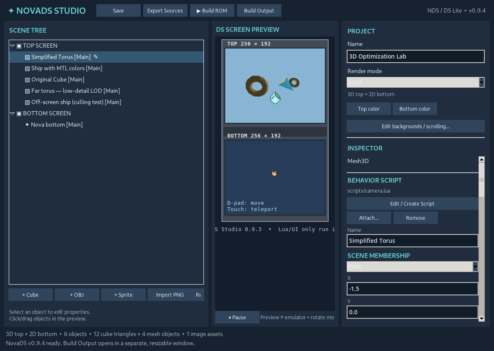
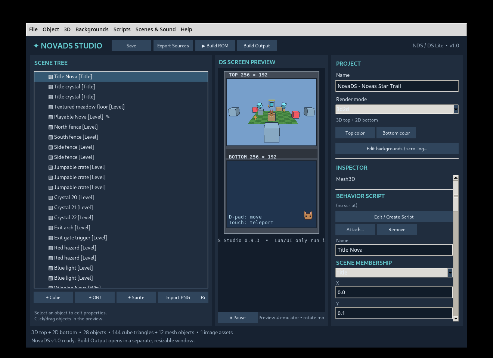

# NovaDS Studio 🦊🎮

**A visual game editor for the original Nintendo DS.** Build scenes with sprites, backgrounds, tilemaps and OBJ models; write gameplay in **real Lua 5.4**; export C source and compile it into an `.nds` homebrew ROM with devkitPro.



**Release:** v1.1.1 · **Editor:** Python / Tkinter · **Runtime:** libnds / ARM9 C / Lua 5.4.9 · **Primary target:** original Nintendo DS / DS Lite (4 MiB RAM).

> **Status:** Real hardware has been used to test the 2D engine and the v1.1 Dual 3D demonstration. Dual 3D remains an **experimental feature**, and your game's performance and compatibility still require testing. See [hardware compatibility](docs/COMPATIBILITY.md).
>
> **License:** Original editor/runtime code and documentation are [MIT-licensed](LICENSE). Included character art, screenshots, sample images, sounds, and artistic models are **not** covered by the code license; see [asset and third-party notices](docs/LICENSING.md).

## Features

- **2D + 2D:** hardware sprites, tilemaps, affine backgrounds, sprite animation, collision, triggers and simple on-screen UI.
- **3D + 2D:** 3D top screen with textured OBJ models, LOD, culling, fog, baked color, 3D transform animation and basic 3D collision; 2D bottom screen.
- **3D + 3D (experimental):** independent camera views on both physical screens, using the DS's single GPU and alternating VRAM frame capture; target 30 new frames/second/screen when overall throughput holds 60 FPS.
- **Real Lua scripting:** object `Start`, `Update`, collisions, audio, input, scene changes and camera operations — no visual-node language required.
- **Exportable projects:** `.novads.json` + PNG/OBJ/MTL/WAV/Lua assets, translated into an editable ARM9/libnds project.
- **Nintendo DS banners:** project name/description/author plus traditional NDS title/subtitle/creator lines and 32×32 custom icon.
- **Original DS-first:** designed around the DS Lite's RAM/VRAM limitations rather than DSi-only enhancements.

## Get started (Windows)

1. Download this repository as ZIP (**Code → Download ZIP**) and extract it, or clone it with Git.
2. Install **Python 3** (Tkinter is included with the standard Windows Python installer). In a terminal at the repository root, run `py -3 -m pip install -r requirements.txt`.
3. Double-click **`Run_NovaDS.bat`** or run `py -3 run_editor.py`.
4. In **File → Open Project**, try `examples/Dual3D_v1.1/Dual3D.novads.json` or `examples/Novas_Star_Trail_v1.0/Novas_Star_Trail.novads.json`.
5. To build a real `.nds`, install the Nintendo DS toolchain (see below); then choose **File → Build .nds ROM**.

On other desktop systems, use `python3 -m pip install -r requirements.txt` and `python3 run_editor.py` (Tkinter must be installed). Windows is the primary supported workflow; the exported ARM9 build is portable to appropriately configured devkitPro environments.

### Building a Nintendo DS ROM

Install [devkitPro](https://devkitpro.org/wiki/Getting_Started) with **devkitARM, libnds and Nintendo DS tools**. In NovaDS, export a game to a folder, then run `make` from a configured devkitPro MSYS2 shell in the exported folder. The output is usually `NovaDS_Game.nds`.

The first build prepares **Lua 5.4.9** from its official archive and verifies its checksum. You'll need internet access once, or a locally supplied Lua tarball. **The repository does not vendor a modified Lua distribution.** See [build walkthrough and troubleshooting](docs/BUILDING.md).

## Examples

| Project | Open in editor | What it demonstrates |
|---|---|---|
| **Dual 3D camera demo (v1.1)** | `examples/Dual3D_v1.1/Dual3D.novads.json` | Independent top/bottom 3D views, captured on alternating frames |
| **Nova's Star Trail (v1.0)** | `examples/Novas_Star_Trail_v1.0/Novas_Star_Trail.novads.json` | Playable 3D mini-game, Lua, sounds, triggers, scenes and collectibles |
| **Physics Playground (v0.7)** | `examples/Physics_Playground_v0.7/Physics_Playground.novads.json` | 2D physics, collision, triggers |
| **Tilemap & Parallax (v0.5.3)** | `examples/Tilemap_Parallax_v0.5.3/Tilemap_Parallax.novads.json` | Scrolling and tilemap editing |

These are editable **source** projects. Buildable exports of some examples are included in `example_export_*` directories. Regenerate an export in the editor whenever you modify a project.



## Documentation

Start with the [documentation index](docs/README.md), including the [beginner guide](docs/manual_v1.0/markdown/01_BEGINNERS_GUIDE.md), [Lua API](docs/manual_v1.0/markdown/03_LUA_API.md), [3D guide](docs/manual_v1.0/markdown/05_3D_GUIDE.md), [v1.1 Dual 3D guide](docs/DUAL_3D_AND_BANNER.md), and [hardware limitations](docs/manual_v1.0/markdown/07_HARDWARE_LIMITS.md).

**Note:** Chapters labeled v1.0 document the earlier API and *predate* Dual 3D; use the v1.1 supplement for the new renderer and banner fields. The PC preview is not a gameplay emulator and does **not** execute Lua or physics.

## Tests and development

Install the Python dependencies, then run:

```bash
python -m unittest tests.test_v11_banner_dual3d tests.test_export tests.test_star_trail_v10 -v
# Broader regression suite:
python -m unittest discover -s tests -p 'test_*.py'
```

These host-side tests check project conversion and generated source, **not** GPU timing or real Nintendo DS execution. A Windows Python smoke-test workflow is provided in `.github/workflows/python-checks.yml`.

See [contributing](CONTRIBUTING.md), [release history](CHANGELOG.md) and [hardware-test evidence](docs/COMPATIBILITY.md).

## Acknowledgements

- [devkitPro](https://devkitpro.org/) / [libnds](https://github.com/devkitPro/libnds) — DS toolchain and hardware API.
- [Lua](https://www.lua.org/) — scripting language, retrieved from the official source archive at build preparation time.
- [Nitro Engine dual-screen documentation](https://github.com/AntonioND/nitro-engine/blob/master/docs/dual-screen-3d-modes.rst) — hardware research reference; NovaDS implements its own alternating-frame path.

NovaDS Studio is an unofficial homebrew project, not affiliated with or endorsed by Nintendo.

## License

NovaDS Studio's original source code and documentation are available under the [MIT License](LICENSE). You can modify the engine, distribute it and use it in commercial or non-commercial games. Example visual/audio/model assets are excluded; see [licensing details](docs/LICENSING.md).
